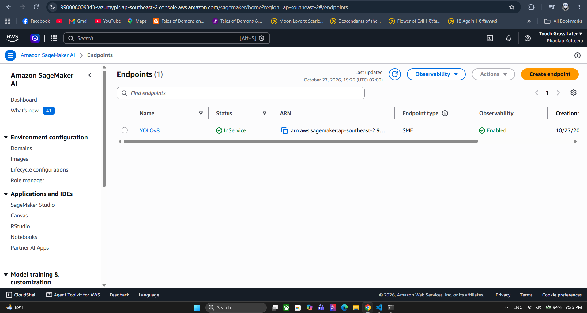
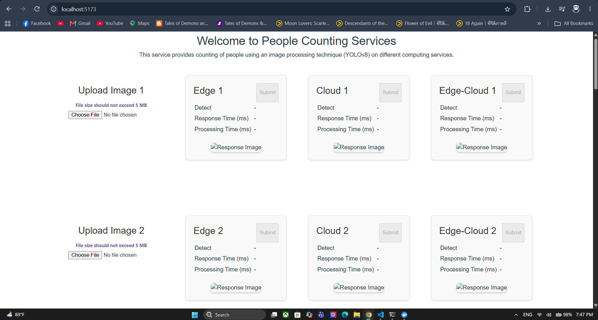

# Assignment Solution: Activity 10 - Edge–Cloud Computing

**Course:** 2110415 Software-Defined System (2026/1)  
**Activity:** People Counting Service using Edge–Cloud Architecture  
**Signed on as:** นายเผ่าลาภ กุลธีระ  
**Due Date:** 2 พฤศจิกายน 2026 เวลา 23:59 น.  
**Total Points:** 5 คะแนน (ข้อละ 1 คะแนน)  

---

## 📂 Part 1: Attach a file to each attachment slot (แนบไฟล์ 3 รายการ - สูงสุด 20 MB/ไฟล์)

### Slot 1: `Screenshot AWS SageMaker (Jupyter Notebook)`
> **คำแนะนำ:** แคปภาพหน้าต่าง Jupyter Notebook (`EndpointDeployment.ipynb`) ขณะรันเซลล์จนแสดงข้อความ `Endpoint Status = InService` หรือภาพหน้า AWS Console ที่แสดง Endpoint `YOLOv8` มีสถานะเป็น InService

```markdown
<!-- วางรูปภาพที่นี่ (บันทึกเป็นชื่อ sagemaker_notebook.png ในโฟลเดอร์เดียวกัน) -->

```

---

### Slot 2: `Screenshot “Welcome to People Counting Services” (Webpage)`
> **คำแนะนำ:** แคปภาพหน้าจอเว็บแอปพลิเคชันที่ URL `http://localhost:5173/` หลังจากสั่งรัน `docker compose up --build` สำเร็จและเบราว์เซอร์เปิดหน้าเว็บขึ้นมาได้

```markdown
<!-- วางรูปภาพที่นี่ (บันทึกเป็นชื่อ webpage_service.png ในโฟลเดอร์เดียวกัน) -->

```

---

### Slot 3: `Completed People counting record sheet (.xlsx)`
> **คำแนะนำ:** ตรวจสอบว่าได้แทรกรูปผลลัพธ์ในเซลล์ (`Insert -> Image -> Insert Image in Cell`) ครบทั้ง 10 รูป และคำนวณค่าเฉลี่ยแถบสีเหลืองครบถ้วนแล้ว บันทึกไฟล์ชื่อ `People counting record sheet.xlsx`

- [ ] รูปที่ 1 - 4 (ภาพตัวอย่างที่กำหนดให้)
- [ ] รูปที่ 5 - 10 (ภาพถ่ายในห้องเรียน พร้อม Ground Truth)
- [ ] กรอกผลการทดลองครบ 3 Trials (Response time, Processing time, People detected)
- [ ] กรอกและคำนวณค่าเฉลี่ยในแถบ Result Summary ครบถ้วน
- [ ] ตรวจสอบขนาดไฟล์ไม่ให้เกิน 20 MB เพื่ออัปโหลดขึ้น myCourseVille ได้อย่างสมบูรณ์

---

## 📊 Part 2: สรุปผลการทดลอง (Experiment Summary Table)
> **คำแนะนำ:** นำตัวเลขเฉลี่ยจากส่วนท้ายของไฟล์ `People counting record sheet.xlsx` มากรอกลงในตารางนี้เพื่อใช้เป็นข้อมูลอ้างอิงในการตอบคำถามข้อ 1:

| Configuration | Average Response Time (ms) | Average Processing Time (ms) | Accuracy (%) |
| :--- | :---: | :---: | :---: |
| **Edge (YOLOv8n)** | `1,304.89 ms` | `1,247.03 ms` | `94.20%` |
| **Cloud (YOLOv8x)** | `2,136.12 ms` | `1,773.48 ms` | `100.00%` |
| **Edge–Cloud (Hybrid)** | `1,942.47 ms` | `1,885.78 ms` | `97.00%` |

---

## 📝 Part 3: Complete the question set (ตอบคำถาม 5 ข้อ รวม 5 คะแนน)

---

### Question 1: Performance comparison (1 point)
> **โจทย์:** In the result summary section (at the end of the record sheet), observe the values of Average Response Time (ms), Average Processing Time (ms), and Accuracy. Identify which configuration (Edge, Cloud, or Edge–Cloud) shows highest or lowest values for each metric. Analyze the reasons behind these differences.

#### 1. การระบุค่าสูงสุด (Highest) และค่าต่ำสุด (Lowest):
- **Average Response Time (ms):**
  - **Highest:** `Cloud` (ค่าเฉลี่ย: `2,136.12` ms)
  - **Lowest:** `Edge` (ค่าเฉลี่ย: `1,304.89` ms)
- **Average Processing Time (ms):**
  - **Highest:** `Edge-Cloud` (ค่าเฉลี่ย: `1,885.78` ms)
  - **Lowest:** `Edge` (ค่าเฉลี่ย: `1,247.03` ms)
- **Accuracy (%):**
  - **Highest:** `Cloud` (ค่าเฉลี่ย: `100.00` %)
  - **Lowest:** `Edge` (ค่าเฉลี่ย: `94.20` %)

#### 2. บทวิเคราะห์สาเหตุเชิงเทคนิค (สามารถคัดลอกข้อความด้านล่างไปใช้ตอบได้ทันที):
```text
สรุปผลการเปรียบเทียบจากแถบ Result Summary:

1. Response Time (เวลาตอบสนอง):
- ต่ำสุด: Edge (1,304.89 ms) เพราะประมวลผลในเครื่องตัวเอง (localhost) ไม่มี Network Latency
- สูงสุด: Cloud (2,136.12 ms) เพราะต้องส่งรูปภาพผ่านอินเทอร์เน็ตไป-กลับ AWS SageMaker (เกิด Network RTT)
- Edge-Cloud อยู่ตรงกลาง (1,942.47 ms) เพราะส่งขึ้นคลาวด์เฉพาะภาพที่โมเดลเล็กไม่มั่นใจ

2. Processing Time (เวลาประมวลผล):
- ต่ำสุด: Edge (1,247.03 ms) เพราะใช้โมเดลเล็ก YOLOv8n (3.2M params) คำนวณเบาและเร็วกว่า
- สูงสุด: Edge-Cloud (1,885.78 ms) เพราะภาพที่มีคนซ้อนกัน ระบบต้องรันโมเดล Edge ก่อน แล้วส่งไปรัน Cloud ซ้ำอีกรอบ ทำให้เวลาบวกกัน
- Cloud ใช้เวลาคงที่ (1,773.48 ms) จากการรันโมเดลใหญ่ YOLOv8x บน vCPU ของ SageMaker

3. Accuracy (ความแม่นยำ):
- สูงสุด: Cloud (100.00%) เพราะใช้โมเดลใหญ่ YOLOv8x (68.2M params) โครงข่ายลึก ตรวจจับคนซ้อนและคนยืนไกลได้ครบถ้วน
- ต่ำสุด: Edge (94.20%) เพราะโมเดลเล็ก YOLOv8n โดนลดทอนความซับซ้อน ทำให้ตรวจหลุดในรูปที่คนยืนบังกัน (เช่น รูปที่ 2 และ 4)
- Edge-Cloud ได้ความแม่นยำสูงถึง 97.00% เพราะส่งเคสที่ Edge ไม่มั่นใจไปให้ Cloud ช่วยตรวจจับแทน
```

---

### Question 2: Suitable use cases (1 point)
> **โจทย์:** Based on the results, which computing setup (Edge, Cloud, or Edge–Cloud) is best suited for different application characteristics/needs/requirements, considering the trade-offs among accuracy, response time, and cost?

#### บทวิเคราะห์และการจัดสรร Use Cases (สามารถคัดลอกข้อความด้านล่างไปใช้ตอบได้ทันที):
```text
วิเคราะห์ความเหมาะสมในการใช้งานตาม Trade-offs (ความแม่นยำ, ความเร็ว, แบนด์วิธ และค่าใช้จ่าย):

1. Edge Computing Setup (เร็วที่สุด, ไม่พึ่งเน็ต, ความเป็นส่วนตัวสูง, ไม่มีค่าบริการคลาวด์):
- จุดเด่นและข้อแลกเปลี่ยน: มี Response Time ต่ำที่สุดและไม่มีค่าบริการคลาวด์รายเดือน ข้อมูลภาพไม่รั่วไหลออกนอกสถานที่ ตอบโจทย์กฎหมาย PDPA และความเป็นส่วนตัว แต่ต้องยอมแลกกับความแม่นยำที่ลดลงเล็กน้อยในจุดที่คนแออัด
- งานที่เหมาะสม: ประตูกั้นชานชาลาหรือทางม้าลายอัจฉริยะ, โดรนสำรวจพื้นที่ทุรกันดารที่ไม่มีสัญญาณเน็ต, กล้องวงจรปิดในห้องปลอดเชื้อหรือพื้นที่ความลับสูงขององค์กร

2. Cloud Computing Setup (แม่นยำสูงสุด 100%, รวมศูนย์ข้อมูลง่าย):
- จุดเด่นและข้อแลกเปลี่ยน: ให้ความแม่นยำสูงที่สุด ตรวจจับได้ละเอียดครบถ้วน และรวมศูนย์ข้อมูลจากหลายจุดได้สะดวก แต่แลกกับเวลาตอบสนองที่ช้าลงจาก Network Latency และมีค่าเช่าบริการคลาวด์ต่อเนื่องตามการใช้งาน
- งานที่เหมาะสม: ระบบคัดกรองความปลอดภัยระดับสูงในสนามบินหรือเรือนจำที่ห้ามตรวจหลุด, การนำวิดีโอจากหลายสาขามาวิเคราะห์สถิติความหนาแน่นคนย้อนหลังรายวัน (Foot-traffic Analytics & Audit)

3. Edge-Cloud (Hybrid) Setup (สมดุลความเร็ว ความแม่นยำ 97% และประหยัดค่าใช้จ่าย):
- จุดเด่นและข้อแลกเปลี่ยน: สถาปัตยกรรมที่ลงตัวที่สุดสำหรับระบบขนาดใหญ่ ภาพทั่วไปประมวลผลจบที่ Edge ทันที ช่วยประหยัดแบนด์วิธและลดจำนวนการเรียกใช้คลาวด์ โดยจะส่งขึ้น Cloud เฉพาะภาพที่โมเดลเล็กไม่มั่นใจ ทำให้ได้ความแม่นยำสูงและคุมค่าใช้จ่ายได้ดีเยี่ยม
- งานที่เหมาะสม: ระบบนับคนในมหาวิทยาลัยและห้างสรรพสินค้า (Smart Campus & Retail) โดยช่วงเวลาปกติที่คนเดินกระจายตัว Edge จะทำงานทันที และจะส่งขึ้น SageMaker เฉพาะจุดที่มีคนยืนบังกันหนาแน่น
```

---

### Question 3: AWS cleanup (1 point)
> **โจทย์:** Have you completed the cleanup step after finishing the assignment to avoid unexpected AWS charges?
> **Pick a choice:**
> - [x] **Yes**

*(คำอธิบายเพิ่มเติมสำหรับการปฏิบัติจริง: ได้ทำการลบ SageMaker Endpoint, Model, Endpoint Configuration, Stop & Delete Notebook Instance `sds-edge-computing`, และลบ IAM Access Key / User `sds-sagemaker` เรียบร้อยแล้ว)*

---

### Question 4: Activity Feedback (1 point)
> **โจทย์:** How difficult was this activity?
> **Pick a choice:**
> - [ ] Too easy
> - [x] **Just right** *(แนะนำ หรือเลือกตามความรู้สึกจริงของผู้เรียน)*
> - [ ] Too difficult

---

### Question 5: Activity Feedback (1 point)
> **โจทย์:** Suggestions for improvement or other feedback.  
> **Compose an answer:**

> **คำแนะนำ:** สามารถนำข้อความตัวอย่างด้านล่างนี้ไปปรับใช้หรือใส่ความคิดเห็นส่วนตัวของผู้เรียนได้เลยครับ:

```text
The activity provides an excellent and comprehensive hands-on experience in comparing Edge, Cloud, and Hybrid computing paradigms. Setting up AWS SageMaker alongside local Docker containers effectively demonstrated the real-world trade-offs between network latency, compute capacity, and detection accuracy.

Suggestions for improvement:
1. It would be helpful to include an automated script or a verification cell in EndpointDeployment.ipynb that explicitly lists remaining active billable resources before notebook shutdown.
2. Providing a clear threshold explanation of the hybrid confidence score logic in the README would help students understand exactly how the offloading decision is tuned.
```
