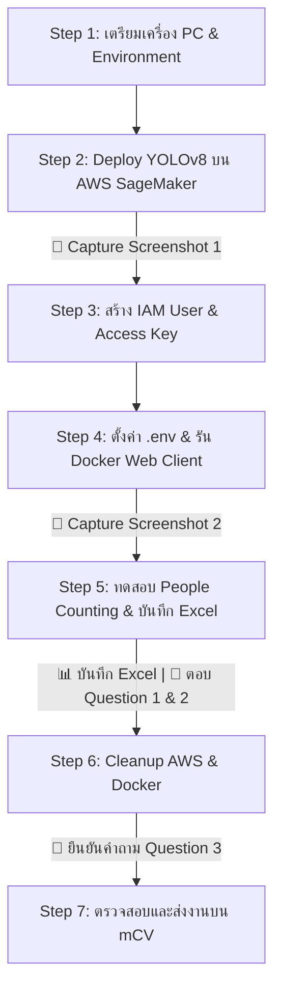

# คู่มือขั้นตอนการทำปฏิบัติการ Activity 10: People Counting Service using Edge–Cloud Architecture

คู่มือนี้จัดทำขึ้นตามเอกสารกิจกรรมอย่างละเอียด โดยมีสัญลักษณ์แจ้งเตือนจุดที่ต้อง **📸 บันทึกภาพหน้าจอ (Capture)**, **📊 บันทึกไฟล์ (File)** หรือ **📝 ตอบคำถาม (Answer Question)** สำหรับส่งงานบนระบบ mCV

---

## 📋 สรุปรายการสิ่งที่จะต้องส่งบนระบบ mCV (Submission Checklist)

### ส่วนที่ 1: แนบไฟล์ (mCV: Attach files)
1. 📸 **Screenshot ที่ 1:** ภาพหน้าจอ AWS SageMaker AI (Jupyter Notebook) ขณะรันจน Endpoint มีสถานะ `InService` *(ได้จากขั้นตอนที่ 2)*
2. 📸 **Screenshot ที่ 2:** ภาพหน้าจอหน้าเว็บ "Welcome to People Counting Services" (`http://localhost:5173/`) *(ได้จากขั้นตอนที่ 4)*
3. 📊 **ไฟล์ที่ 3:** ไฟล์สเปรดชีต `People counting record sheet.xlsx` ที่กรอกข้อมูลและแทรกรูปครบถ้วน *(ได้จากขั้นตอนที่ 5)*

### ส่วนที่ 2: ตอบคำถาม (mCV: Answer the questions)
1. 📝 **Question 1 (Performance comparison):** เปรียบเทียบ Average Response Time, Average Processing Time และ Average Accuracy พร้อมวิเคราะห์เหตุผล *(ตอบหลังจบขั้นตอนที่ 5)*
2. 📝 **Question 2 (Suitable use cases):** วิเคราะห์ความเหมาะสมในการนำไปใช้งาน (Use cases) และ Trade-offs ของแต่ละสถาปัตยกรรม *(ตอบหลังจบขั้นตอนที่ 5)*
3. 📝 **Question 3 (AWS cleanup):** ยืนยันว่าได้ทำขั้นตอน Cleanup ทรัพยากรบน AWS เรียบร้อยแล้ว *(ตอบหลังจบขั้นตอนที่ 6)*

---

## 🛠️ รายละเอียดขั้นตอนการปฏิบัติการทีละ Step



---

### Step 1: เตรียมเครื่อง Personal Computer และสภาพแวดล้อม
1. ตรวจสอบว่าได้เปิดโปรแกรม **Docker Desktop** บนเครื่อง PC แล้ว
2. เปิด Terminal (Command Prompt หรือ PowerShell) แล้ว Clone repository ของกิจกรรม:
   ```bash
   git clone https://github.com/paychorn/sds-edge-computing.git
   cd sds-edge-computing
   ```
3. สร้าง Python Virtual Environment สำหรับงานนี้:
   - **Windows:**
     ```bash
     python -m venv sds
     ```
4. ทำการ Activate Virtual Environment:
   - สำหรับ **PowerShell**:
     ```powershell
     .\sds\Scripts\Activate.ps1
     ```
   - สำหรับ **Command Prompt (CMD)**:
     ```cmd
     .\sds\Scripts\activate
     ```
5. ติดตั้งแพ็กเกจ Python ที่จำเป็น:
   ```bash
   pip install opencv-python
   ```

---

### Step 2: ตั้งค่าและ Deploy โมเดลบน Amazon SageMaker AI
1. เข้าใช้งาน **AWS Management Console** และตรวจสอบ Region ให้เป็น:
   > 🌐 **Asia Pacific (Singapore) `ap-southeast-1`** (มุมขวาบน)
2. ค้นหาบริการ **Amazon SageMaker** (หรือ Amazon SageMaker AI)
3. ที่เมนูด้านซ้ายใต้หัวข้อ *Applications and IDEs* เลือก **Notebook** $\rightarrow$ คลิกแท็บ **Notebook instances**
4. คลิกปุ่มสีส้ม **Create notebook instance** แล้วตั้งค่าดังนี้:
   - **Notebook instance name:** `sds-edge-computing`
   - **Notebook instance type:** `ml.t3.medium`
   - **Platform identifier:** `Amazon Linux 2, Jupyter Lab 4`
   - **Permissions and encryption:** 
     - ในหัวข้อ *IAM role* ให้คลิกเลือก **Create a new role**
     - ในหน้าต่างป๊อปอัป ให้เลือกสิทธิ์ S3 buckets เป็น **Any S3 bucket** แล้วคลิก **Create role**
   - คลิกปุ่ม **Create notebook instance** ที่ด้านล่างสุด
5. รอจนกระทั่ง Notebook instance มีสถานะ (Status) เป็น **`InService`** (ใช้เวลาประมาณ 3–5 นาที)
6. เมื่อพร้อมใช้งาน ให้คลิก **Open Jupyter** (หรือ Open JupyterLab):
   - คลิกปุ่ม **Upload** เพื่อนำไฟล์ทั้งหมดที่อยู่ในโฟลเดอร์ `cloud/` (จาก repo `sds-edge-computing` ที่ clone มา) ขึ้นสู่ Jupyter Notebook
   - ดับเบิลคลิกเปิดไฟล์ `EndpointDeployment.ipynb`
   - ตรวจสอบ Kernel ให้เป็น **`conda_pytorch`** (มุมขวาบน)
   - **รันทุก Code Cell ที่อยู่ด้านบนส่วน "Cleanup"** (ห้ามรันส่วน Cleanup ในขั้นตอนนี้)
   - สังเกตผลลัพธ์ใน Terminal/Cell ด้านล่าง รอจนปรากฏข้อความ:
     ```text
     Endpoint Status = InService
     ```
   - ไปที่ AWS Console: *Amazon SageMaker AI* $\rightarrow$ *Deployments & inference* $\rightarrow$ *Endpoints* ตรวจสอบว่า Endpoint ชื่อ `YOLOv8` มีสถานะเป็น **InService**

> [!IMPORTANT]
> ### 📸 [จุดที่ต้อง CAPTURE #1]: AWS SageMaker AI Notebook
> **สิ่งที่จะต้องทำทันทีหลังเสร็จสิ้น Step 2:**
> 1. แคปภาพหน้าจอ **Jupyter Notebook (`EndpointDeployment.ipynb`)** ที่แสดงผลลัพธ์เซลล์สุดท้ายว่า `Endpoint Status = InService` หรือหน้า AWS Console ที่แสดง Endpoint `YOLOv8` เป็นสถานะ `InService`
> 2. นำภาพไปวางลงใน `sol.md` (หัวข้อ Screenshot 1) และเตรียมไว้อัปโหลดในช่อง **mCV: Attach files ข้อที่ 1**

---

### Step 3: สร้าง IAM User และ Access Key สำหรับเชื่อมต่อ API
1. ไปที่ AWS Console $\rightarrow$ ค้นหาบริการ **IAM**
2. ไปที่เมนู **Users** (ในแถบ Access management ด้านซ้าย) $\rightarrow$ คลิก **Create user**
3. ตั้งชื่อผู้ใช้ (User name): `sds-sagemaker` $\rightarrow$ คลิก **Next**
4. ในหน้า Permissions options:
   - เลือก **Attach policies directly**
   - ในช่องค้นหา พิมพ์: `AmazonSageMakerFullAccess` แล้วติ๊กเลือก
   - คลิก **Next** $\rightarrow$ คลิก **Create user**
5. สร้าง Access Key:
   - คลิกเลือกชื่อผู้ใช้ `sds-sagemaker` ที่เพิ่งสร้างเสร็จ
   - คลิกแท็บ **Security credentials**
   - เลื่อนลงไปที่ส่วน *Access keys* แล้วคลิก **Create access key**
   - เลือก Use case เป็น: **Other** $\rightarrow$ คลิก **Next** $\rightarrow$ คลิก **Create access key**
   - **คัดลอกหรือดาวน์โหลดไฟล์ `.csv` เก็บค่า:**
     - `ACCESS_KEY_ID`
     - `SECRET_ACCESS_KEY`
     *(สำคัญมาก: Secret Access Key จะไม่สามารถดูได้อีกเมื่อปิดหน้านี้)*
   - คลิก **Done** และตรวจสอบว่า Access Key มีสถานะเป็น **Active**

---

### Step 4: ตั้งค่าคอนฟิก Local PC และรันระบบผ่าน Docker Desktop
1. กลับมาที่เครื่อง Local PC ในโฟลเดอร์ `sds-edge-computing`
2. สร้างไฟล์ชื่อ `.env` ขึ้นมา (โดยดูตัวอย่างจาก `.env.example`) และกรอกค่า Credentials จาก Step 3:
   ```env
   # Shared AWS credentials
   AWS_ACCESS_KEY_ID=<ใส่ ACCESS_KEY_ID ของคุณ>
   AWS_SECRET_ACCESS_KEY=<ใส่ SECRET_ACCESS_KEY ของคุณ>
   AWS_REGION=ap-southeast-1

   # Client (Vite)
   VITE_EDGE_URL=http://127.0.0.1:5001
   VITE_HYBRID_URL=http://127.0.0.1:5002
   VITE_CLOUD_REGION=ap-southeast-1
   VITE_ACCESS_KEY_ID=<ใส่ ACCESS_KEY_ID ของคุณ>
   VITE_SECRET_ACCESS_KEY=<ใส่ SECRET_ACCESS_KEY ของคุณ>
   VITE_ENDPOINT_NAME=YOLOv8
   ```
3. รัน Docker Compose เพื่อเริ่มการทำงานทั้ง 3 Services (Edge, Hybrid, Client):
   ```bash
   docker compose up --build
   ```
   *(ขั้นตอนนี้จะดาวน์โหลดและติดตั้ง Image อาจใช้เวลาประมาณ 5–10 นาทีในการรันครั้งแรก)*
4. เมื่อ Container ทุกตัวเริ่มทำงานเรียบร้อย ให้เปิดเว็บเบราว์เซอร์ไปที่:
   ```
   http://localhost:5173/
   ```
   จะพบกับหน้าเว็บหัวข้อ **"Welcome to People Counting Services"**

> [!IMPORTANT]
> ### 📸 [จุดที่ต้อง CAPTURE #2]: Web Application
> **สิ่งที่จะต้องทำทันทีหลังเสร็จสิ้น Step 4:**
> 1. แคปภาพหน้าจอหน้าเว็บ **"Welcome to People Counting Services"** ที่ URL `http://localhost:5173/`
> 2. นำภาพไปวางลงใน `sol.md` (หัวข้อ Screenshot 2) และเตรียมไว้อัปโหลดในช่อง **mCV: Attach files ข้อที่ 2**

---

### Step 5: ทดสอบ People Counting และบันทึกผลการทดลอง
1. เปิดไฟล์ `People counting record sheet.xlsx` ที่อยู่ในโฟลเดอร์ `sds-edge-computing`
2. เตรียมรูปภาพทดสอบจำนวน 10 รูป:
   - **รูปที่ 1 ถึง 4:** ใช้รูปตัวอย่างที่มีให้ในโฟลเดอร์กิจกรรม (`1.jpg`, `2.jpg`, `3.jpg`, `4.jpg`)
   - **รูปที่ 5 ถึง 10:** ถ่ายรูปผู้คนในห้องเรียน/ห้องที่มีจำนวนคนแตกต่างกัน และ**นับจำนวนคนที่แท้จริง (Ground Truth)** บันทึกไว้เพื่อใช้คำนวณความถูกต้อง
3. ดำเนินการทดสอบผ่านหน้าเว็บ `http://localhost:5173/`:
   - คลิก **Choose File** เพื่อเลือกรูปภาพ
   - คลิกปุ่ม **Submit** เพื่อส่งรูปไปประมวลผลพร้อมกันทั้ง 3 บริการ (Edge, Cloud, Edge-Cloud)
   - บันทึกผลลัพธ์ของแต่ละรูป:
     - **Result image:** บันทึกรูปภาพผลลัพธ์ที่มีกรอบ Bounding box และนำไปแทรกลงในเซลล์ Excel โดยใช้คำสั่ง:
       > เมนู Excel: `Insert` $\rightarrow$ `Image` $\rightarrow$ `Insert Image in Cell` *(เพื่อไม่ให้ไฟล์ Excel มีขนาดเกิน 20 MB)*
     - **Number of people detected:** บันทึกจำนวนคนที่แต่ละบริการตรวจจับได้
     - **Processing time (ms):** ทำการทดสอบ 3 ครั้ง (Trials) แล้วบันทึกค่า
     - **Response time (ms):** ทำการทดสอบ 3 ครั้ง (Trials) แล้วบันทึกค่า
     *(ข้อแนะนำ: การยิง Request ครั้งแรกอาจช้าเนื่องจาก Initialization/Cold start สามารถข้ามหรือทดสอบซ้ำเพื่อให้ได้ค่าคงที่ได้)*
4. กรอกข้อมูลให้ครบถ้วนทุกช่องที่มี **แถบสีเหลือง** ในไฟล์ Excel รวมถึงแถวสรุปผลเฉลี่ย (Result Summary) ท้ายตาราง

> [!IMPORTANT]
> ### 📊 [จุดที่ต้องบันทึกไฟล์ #3]: Completed Excel Record Sheet
> - บันทึกและตรวจสอบไฟล์ `People counting record sheet.xlsx` ว่าได้ใส่ภาพในเซลล์และคำนวณค่าเฉลี่ยครบทุกช่องแล้ว
> - เตรียมไฟล์นี้สำหรับอัปโหลดในช่อง **mCV: Attach files ข้อที่ 3**

> [!TIP]
> ### 📝 [จุดที่ต้องตอบคำถาม QUESTION 1 & 2 บน mCV]
> เมื่อกรอกข้อมูลใน Excel เสร็จสิ้น ให้นำค่าจากแถบ **Result summary** มาวิเคราะห์เพื่อตอบคำถาม:
> 
> 1. **ตอบ Question 1 (Performance comparison):**
>    - นำค่า `Average Response Time (ms)`, `Average Processing Time (ms)` และ `Average Accuracy (%)` ของแต่ละบริการมาเปรียบเทียบ
>    - ชี้ชัดว่าบริการใดได้ค่า **สูงสุด (Highest)** และ **ต่ำสุด (Lowest)** ในแต่ละค่า
>    - อธิบายสาเหตุทางเทคนิค (ผลกระทบของ Network RTT / การส่งผ่าน Internet, ความซับซ้อนของ YOLOv8n vs YOLOv8x, และการทำงานของระบบ Hybrid)
> 2. **ตอบ Question 2 (Suitable use cases):**
>    - สรุปว่า Edge, Cloud และ Edge-Cloud เหมาะสมกับ Use case ลักษณะใด โดยคำนึงถึง Accuracy, Response Time, Bandwidth และ Cost
>    *(คุณสามารถนำโครงร่างคำตอบจากไฟล์ `sol.md` ไปปรับแต่งใช้ตอบได้ทันที)*

---

### Step 6: ลบทรัพยากรเพื่อป้องกันค่าใช้จ่าย (AWS Cleanup & Teardown)
> [!CAUTION]
> **ขั้นตอนนี้สำคัญมาก!** ต้องทำหลังบันทึกผลการทดลองเสร็จเรียบร้อยแล้ว เพื่อป้องกันไม่ให้ถูกหักเงิน/เครดิตจาก AWS SageMaker

1. **ปิดการทำงานบน Local PC:**
   - ที่ Terminal ในโฟลเดอร์ `sds-edge-computing` รันคำสั่ง:
     ```bash
     docker compose down
     ```
2. **ลบโมเดลและ Endpoint บน AWS SageMaker:**
   - กลับไปที่ Jupyter Notebook (`EndpointDeployment.ipynb`)
   - เลื่อนลงไปที่หัวข้อ **Cleanup** ด้านล่างสุด แล้วรัน Code Cells ทั้งหมดในส่วน Cleanup เพื่อสั่งลบ:
     - Endpoint (`YOLOv8`)
     - Endpoint Configuration
     - Deployable Model
   - ตรวจสอบใน AWS Console: SageMaker $\rightarrow$ *Deployments & inference* ตรวจสอบว่า Endpoints, Endpoint configurations และ Models ถูกลบออกทั้งหมดแล้ว
3. **หยุดและลบ Notebook Instance:**
   - ไปที่ SageMaker $\rightarrow$ *Notebook instances*
   - เลือก `sds-edge-computing` $\rightarrow$ คลิก **Actions** $\rightarrow$ เลือก **Stop**
   - รอจนกระทั่งสถานะเปลี่ยนเป็น **`Stopped`**
   - คลิก **Actions** $\rightarrow$ เลือก **Delete** เพื่อลบ Notebook instance ทิ้งอย่างถาวร
4. **ลบ IAM User และ Access Key:**
   - ไปที่บริการ **IAM** $\rightarrow$ เมนู **Users**
   - คลิกเลือก `sds-sagemaker` $\rightarrow$ แท็บ **Security credentials**
   - ที่หัวข้อ *Access keys* กดเลือก **Deactivate** แล้วกด **Delete**
   - กลับมาที่หน้ารายชื่อ Users ติ๊กเลือก `sds-sagemaker` แล้วกด **Delete** เพื่อลบ User

> [!IMPORTANT]
> ### 📝 [จุดที่ต้องตอบคำถาม QUESTION 3 บน mCV]
> เมื่อทำขั้นตอน Cleanup ครบทั้ง 4 ข้อข้างต้นแล้ว ให้นำไปตอบในช่อง **mCV: Answer the questions ข้อ 3 (AWS cleanup)** ว่าได้ดำเนินการลบเรียบร้อยแล้ว

---

### Step 7: ตรวจสอบและส่งงานบนระบบ mCV
ก่อนกด Submit บน mCV ให้ตรวจสอบความครบถ้วนอีกครั้ง:
- [ ] แนบไฟล์ Screenshot 1: SageMaker Jupyter Notebook
- [ ] แนบไฟล์ Screenshot 2: หน้าเว็บ People Counting Services
- [ ] แนบไฟล์ Excel: `People counting record sheet.xlsx`
- [ ] กรอกคำตอบ Question 1 (Performance comparison)
- [ ] กรอกคำตอบ Question 2 (Suitable use cases)
- [ ] กรอกคำตอบ Question 3 (AWS cleanup confirmation)
