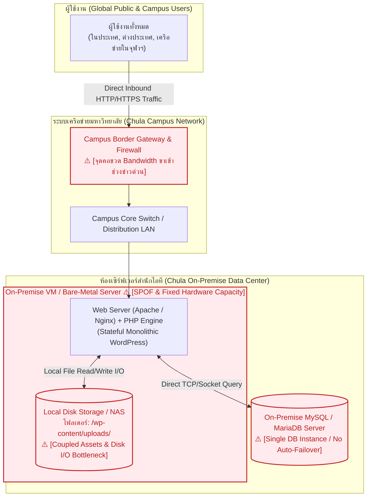
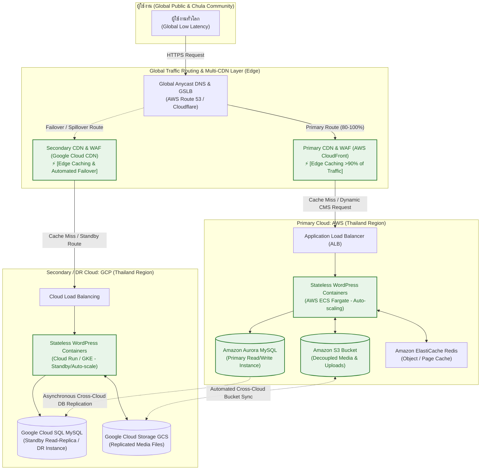

# สถาปัตยกรรมสำหรับ Slide 4-5: www.chula.ac.th (Activity 8)
**วิชา:** 2110415 Software-Defined Systems  
**หัวข้อ:** Comparison of Old (On-Premise) vs New (Multi-Cloud) Architecture for `www.chula.ac.th`

---

## 1. เปรียบเทียบแผนภาพสถาปัตยกรรม (Architecture Diagrams)

### 1.1 สถาปัตยกรรมเดิม (Old Architecture: Traditional On-Premise Monolithic)
สถาปัตยกรรมแบบดั้งเดิมที่เซิร์ฟเวอร์ทั้งหมดติดตั้งอยู่ภายในห้อง Data Center ของจุฬาลงกรณ์มหาวิทยาลัย:

> **ปัญหาเชิงสถาปัตยกรรมของระบบเดิม (Architectural Bottlenecks):**
> 1. **Single Point of Failure (SPOF):** หากห้อง Data Center จุฬาฯ ไฟดับ, สวิตช์หลักเสีย, หรือสาย Fiber ขาด เว็บหลักของมหาวิทยาลัยจะเข้าไม่ได้ทั่วโลกทันที
> 2. **Network Bandwidth Saturation:** ทราฟฟิกทั้งหมดวิ่งตรงเข้ามหาวิทยาลัย หากมีข่าวด่วนหรือคนเปิดดูคลิป/รูปภาพพร้อมกัน ท่อเน็ตเวิร์กของมหาวิทยาลัยจะเต็ม
> 3. **Fixed Compute & Coupled Storage:** ขยายเครื่อง (Scale out) ไม่ได้ในทันที และรูปภาพ/ไฟล์ข่าวถูกบันทึกลง Hard Disk ของเครื่องเซิร์ฟเวอร์ ทำให้เครื่องทำงานหนักทั้ง Web Serving และ Disk I/O

---

### 1.2 สถาปัตยกรรมใหม่ (New Architecture: Modern Multi-Cloud Architecture)
สถาปัตยกรรมใหม่ที่ย้ายขึ้น Public Cloud ข้าม 2 ผู้ให้บริการ (AWS + GCP) แยก Layer อย่างอิสระ:

---

### 1.3 ตารางเปรียบเทียบสถาปัตยกรรมระดับ Layer (Architectural Transformation)

| Architectural Layer | สถาปัตยกรรมเดิม (On-Premise) | สถาปัตยกรรมใหม่ (Multi-Cloud) | ประโยชน์ของการเปลี่ยนแปลง |
| :--- | :--- | :--- | :--- |
| **Ingress & Caching** | วิ่งตรงผ่าน Campus Gateway ของจุฬาฯ ไม่มี CDN สากล | **Anycast DNS + Multi-CDN (CloudFront + Cloud CDN)** | ตัดภาระโหลดของ Origin Server ได้กว่า 90-95% เปิดจากต่างประเทศได้เร็วทันที |
| **Compute & Scaling** | Monolithic VM / Bare-metal เครื่องเดียว ขยายเครื่องไม่ได้ทันที | **Stateless Containers (ECS / Cloud Run)** รองรับ Horizontal Pod Autoscaling | ยืดหดเครื่องอัตโนมัติตามปริมาณข่าวด่วน (Elastic Scalability) ภายในหลักนาที |
| **Storage & Assets** | Local Server Disk / NAS (`wp-content/uploads`) ผูกติดกับเครื่อง | **Decoupled Object Storage (AWS S3 + GCP Cloud Storage)** | แยกไฟล์มีเดียออกจากตัวเว็บ ไม่เปลืองดิสก์เซิร์ฟเวอร์ ทนทานระดับ 99.999999999% |
| **Database & State** | Single MySQL Instance ในศูนย์คอมฯ จุฬาฯ ไม่มี Failover อัตโนมัติ | **Managed Relational DB (Aurora MySQL) + Cross-Cloud Read Replica (Cloud SQL)** | ทำ Disaster Recovery ข้ามคลาวด์ ป้องกันฐานข้อมูลล่ม 100% |
| **High Availability** | ขึ้นอยู่กับ Data Center จุฬาฯ (SPOF สูง) | **Multi-Provider Resiliency (AWS + GCP)** | คลาวด์เจ้าหนึ่งล่ม อีกเจ้าให้บริการต่อได้ทันทีอย่างไร้รอยต่อ (Uptime 99.99%+) |

---

## 2. ข้อ 1: การออกแบบ Final Architecture (Multi-Cloud Pattern)

### ทำไมถึงเลือก "Multi-Cloud" แทน "Hybrid Cloud"?
1. **ธรรมชาติของระบบ (Public Read-Heavy Portal):**  
   `www.chula.ac.th` เป็นเว็บประชาสัมพันธ์และหน้าตาของมหาวิทยาลัย ข้อมูลทั้งหมดเป็นสาธารณะ (Public Data) ไม่มีความลับของข้อมูลนิสิตหรือข้อจำกัดด้าน PDPA ที่จำเป็นต้องเก็บกักไว้ใน Local On-Premise เหมือนระบบทะเบียน (`Reg Chula`)
2. **ความต้องการด้าน Uptime และ Disaster Recovery ระดับสูงสุด:**  
   หากเกิดภัยพิบัติหรือ Cloud เจ้าใดเจ้าหนึ่งล่มทั้ง Region ระบบจะสามารถ Failover ไปยัง Cloud อีกเจ้าได้ทันที ทำให้เว็บมหาวิทยาลัยมี Uptime 99.99%+ ตลอดเวลา
3. **กำจัดคอขวดของ On-premise อย่างสิ้นเชิง:**  
   ไม่ต้องพึ่งพาระบบเครือข่ายหรือห้องเซิร์ฟเวอร์ภายในมหาวิทยาลัย

### รายละเอียดการทำงานของแต่ละ Layer:
* **Layer 1: Global Routing & Multi-CDN Layer:**
  * ใช้ **Global Server Load Balancing (GSLB)** ตรวจเช็ค Health check ตลอดเวลา หากเกิดเหตุขัดข้องจะสลับ DNS ไปยังคลาวด์สำรองโดยอัตโนมัติ
  * แคชเนื้อหาข่าว สารสนเทศ รูปภาพ และไฟล์สถิติไว้ที่ Edge Servers ทั่วโลก ทราฟฟิกกว่า **90-95% จะถูกส่งจาก Edge ทันที** โดยไม่ต้องวิ่งเข้าเครื่องเซิร์ฟเวอร์
* **Layer 2: Compute Layer (Stateless Web Containers):**
  * สถาปัตยกรรม WordPress ถูกแยกให้เป็น **Stateless (ไร้สถานะ)** ทั้งหมด
  * รันบน Container (AWS Fargate และ GCP Cloud Run/GKE) พร้อมระบบ **Horizontal Pod Autoscaling (HPA)** ที่ยืดหดจำนวนเซิร์ฟเวอร์ได้อัตโนมัติตามโหลดผู้ใช้งาน
* **Layer 3: Storage Layer (Decoupled Assets):**
  * ไฟล์รูปภาพ ข่าวสาร และเอกสาร PDF (`wp-content/uploads`) ถูกแยกออกจากเซิร์ฟเวอร์ไปเก็บใน Object Storage (AWS S3) และซิงก์แบบสองทางไปยัง Google Cloud Storage (GCS)
* **Layer 4: Database Layer (Cross-Cloud DR):**
  * ใช้ Managed Relational Database (Amazon Aurora MySQL) เป็นโหนดหลัก (Active Read/Write) สำหรับแอดมินโพสต์ข่าว และทำ Async Replication ข้ามไปยัง Google Cloud SQL เป็นตัวสำรอง (Standby/DR)

---

## 3. ข้อ 2: การวิเคราะห์ข้อดีและข้อเสีย (Pros & Cons)

### ข้อดี (Pros):
1. **High Availability & Fault Tolerance สูงสุด (Zero Single Point of Failure):**  
   ไม่มีจุดล่มจุดเดียว หากระบบของ AWS ขัดข้อง ระบบจะสลับไปยัง GCP อัตโนมัติ เว็บมหาวิทยาลัยไม่มีวันดับ
2. **Near-Infinite Scalability (รองรับ Spike สบาย):**  
   เมื่อเกิดเหตุการณ์สำคัญระดับประเทศ (เช่น วันประกาศ TCAS, ข่าวด่วนมหาวิทยาลัย, งานพระราชทานปริญญาบัตร) Auto-scaling จะเพิ่มเครื่องรองรับผู้ใช้งานหลักแสนได้ภายในเวลาไม่กี่นาที
3. **Global Performance & Low Latency:**  
   ชาวต่างชาติ สถาบันจัดอันดับมหาวิทยาลัยโลก (QS / THE World University Rankings) หรือนิสิตต่างชาติเปิดดูเว็บได้เร็วเท่ากับคนในประเทศไทย เพราะข้อมูลถูกส่งจาก Edge CDN ที่อยู่ใกล้ที่สุด
4. **ป้องกันการโจมตีระดับ Terabits (DDoS Protection):**  
   Cloud WAF และ CDN ช่วยกรองบอทและการยิง DDoS ให้จบตั้งแต่ระดับ Edge โดยไม่กระทบเซิร์ฟเวอร์จริง
5. **No On-premise Hardware Maintenance:**  
   บุคลากรไอทีมหาวิทยาลัยไม่ต้องเสียเวลากับการเปลี่ยนอะไหล่ฮาร์ดดิสก์ แอร์ห้องเซิร์ฟเวอร์ดับ หรือระบบสำรองไฟสำรอง

### ข้อเสีย (Cons):
1. **Operational & Architectural Complexity:**  
   การดูแลระบบข้าม 2 Cloud ผู้ดูแลระบบต้องมีทักษะระดับสูง เช่น การเขียน Infrastructure as Code (Terraform), การจัดการ CI/CD และความเข้าใจคอนฟิกทั้ง AWS และ Google Cloud
2. **Cross-Cloud Data Transfer Cost (Egress Fee):**  
   มีค่าใช้จ่ายในการถ่ายโอนข้อมูลข้ามคลาวด์ โดยเฉพาะการ Replicate ข้อมูล Database และการ Sync สตอเรจมีเดียข้ามค่าย
3. **Data Consistency Latency:**  
   การจำลองฐานข้อมูลข้ามคลาวด์เป็นแบบ Asynchronous อาจมีความล่าช้าในการ Sync เล็กน้อย (เสี้ยววินาที) หากเกิด Failover กะทันหัน

---

## 4. ข้อ 3: Shortcomings ที่ยังคงเหลืออยู่เมื่อเทียบกับ On-Premise

สิ่งที่อาจารย์เน้นถามในโจทย์คือ **"แม้จะย้ายขึ้น Cloud สถาปัตยกรรมใหม่นี้ยังมีจุดด้อยอะไรเมื่อเทียบกับ On-premise ดั้งเดิม?"**:

1. **การเปลี่ยนรูปแบบต้นทุนจากคงที่เป็นแบบผันแปร (Opex vs Capex) & เสี่ยง Bill Shock:**  
   * *On-premise:* เป็นต้นทุนคงที่ (Capex) จ่ายค่าเซิร์ฟเวอร์ครั้งเดียว คำนวณงบประมาณรายปีของมหาวิทยาลัยได้แน่นอน  
   * *Multi-Cloud:* เป็นต้นทุนแปรผันตามการใช้งานจริง (Opex) หากเว็บถูกบอทสแครป หรือทีมงานคอนฟิก CDN Cache Policy ผิดพลาดจนรีเควสต์หลุดมาที่ Origin อาจทำให้งบประมาณคลาวด์พุ่งสูงเกินควบคุม
2. **การสูญเสียการควบคุมระดับกายภาพ (Loss of Low-Level Infrastructure Control):**  
   * มหาวิทยาลัยไม่สามารถเข้าถึงหรือควบคุม Hardware/Hypervisor ได้โดยตรง ต้องพึ่งพาข้อตกลงระดับบริการ (SLA) ของผู้ให้บริการคลาวด์ หากเกิดปัญหาเชิงลึกระดับคลาวด์ทำได้เพียงรอทาง Provider แก้ไข
3. **ต้องปรับทักษะของบุคลากรภายใน (Staff Reskilling):**  
   * บุคลากรฝ่ายไอทีของมหาวิทยาลัยที่คุ้นเคยกับการดูแล System Admin แบบ On-premise ดั้งเดิม ต้องปรับตัวและผ่านการเทรนทักษะด้าน Cloud Architecture และ Cloud Security อย่างหนัก

---

## 5. สรุปเนื้อหาสำหรับจัดใส่ Slide 4 และ Slide 5 (Presentation Ready)

### 📌 Slide 4: Architecture Evolution (Old vs New Architecture)
* **หัวข้อสไลด์:** Evolution of Architecture for `www.chula.ac.th` (On-Premise vs Multi-Cloud)
* **การวาง Layout ในสไลด์:**
  * **ฝั่งซ้าย:** แผนภาพ Old Architecture (แสดงจุดอ่อน: Campus Gateway Bottleneck, Single Server SPOF, Local Storage)
  * **ฝั่งขวา:** แผนภาพ New Multi-Cloud Architecture (แสดงจุดแข็ง: Edge Multi-CDN, Stateless Containers, S3/GCS Decoupled Storage, Cross-Cloud DB Replication)
* **Bullet Points อธิบายสไลด์:**
  * ปรับเปลี่ยนจาก Monolithic On-Premise สู่ **Multi-Cloud (AWS + GCP)** เพื่อกำจัด Single Point of Failure
  * ข้อมูลข่าวสารเป็น Public Content จึงแคชไว้ที่ Multi-CDN Edge ได้มากกว่า 90%
  * ใช้ Stateless Containers ร่วมกับ Auto-scaling เพื่อรองรับทราฟฟิกข่าวด่วนได้ทันที

---

### 📌 Slide 5: Evaluation (Pros, Cons & Remaining Shortcomings)
* **หัวข้อสไลด์:** Architectural Evaluation & Trade-offs
* **ตารางสรุปเปรียบเทียบ:**

| มิติการประเมิน | On-Premise ดั้งเดิม | Multi-Cloud ใหม่ |
| :--- | :--- | :--- |
| **High Availability** | ⚠️ ต่ำ (เสี่ยงดับทั้งเว็บจากระบบไฟ/เน็ตเวิร์กจุฬาฯ) | ✅ **สูงมาก 99.99%+** (ทนทานต่อ Cloud ค่ายใดค่ายหนึ่งล่ม) |
| **Scalability** | ⚠️ ตายตัวตามฮาร์ดแวร์ ขยายเครื่องไม่ทันทราฟฟิก | ✅ **Auto-scale ยืดหดได้ในระดับนาที** |
| **Global Access** | ⚠️ ช้าเมื่อเปิดจากต่างประเทศ | ✅ **เร็วทั่วโลกด้วย Multi-CDN Edge** |

* **Remaining Shortcomings (ข้อจำกัดที่ยังเหลืออยู่เมื่อเทียบกับ On-Premise):**
  1. **Cost Model Transition:** เปลี่ยนเป็น Opex จ่ายตามจริง เสี่ยงงบประมาณบานปลาย (Bill Shock) หากคอนฟิก CDN หลุด ต่างจาก On-premise ที่งบประมาณ Capex คงที่
  2. **Operational Overhead:** ซับซ้อนกว่า ต้องใช้ทีมงานที่เชี่ยวชาญ Multi-Cloud DevOps (Terraform / CI/CD)
  3. **Loss of Infrastructure Control:** มหาวิทยาลัยไม่ได้เป็นเจ้าของฮาร์ดแวร์ ต้องพึ่งพา SLA ของ Cloud Provider ภายนอก
